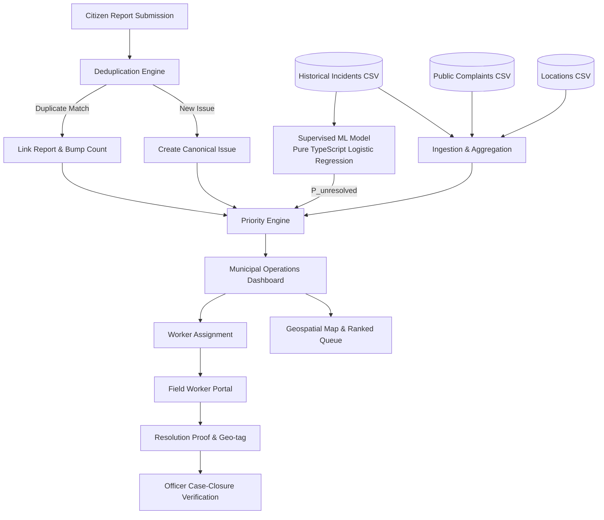

# Nagrik — Datathon Round 1 Prototype
> **"One civic issue, many citizen reports, one evidence-backed priority, and a verified path to resolution."**

---

## 1. Executive Summary & Vision

**Nagrik** is an explainable civic-issue prioritization and resolution platform for smart cities. It bridges the gap between public dissatisfaction and municipal action:

1. **Citizen Reporting Portal**: Mobile-responsive, high-contrast interface allowing citizens to photograph potholes, flooding, drainage issues, or traffic signal outages, capture or pin their coordinates, and receive instant trackable issue reference IDs with local persistence.
2. **Intelligent Deduplication & Priority Scoring**: Automatically identifies and groups duplicate reports within spatial and temporal proximity, incrementing confirmation evidence without score inflation.
3. **Supervised ML Logistic Regression (Built from Scratch in TypeScript)**: Predicts the likelihood that a reported incident remains unresolved based on historical incident patterns—without any third-party ML API dependencies.
4. **Municipal Operations Dashboard**: A command-center interface displaying top-priority locations, geospatial maps colored by priority band (Critical, High, Medium, Low), score breakdowns, and an **Intervention Comparison Panel**.
5. **Field Worker Workflow & Case-Closure Tracker**: Field workers receive assigned tasks, update progress, and upload geo-tagged resolution photographs. Municipal officers verify closure proofs before resolving or reopening cases.

> **Data Disclosure**: Per the dataset specifications, all coordinates, incidents, and complaints displayed on the map and dashboard are **simulated educational data**. No official municipal ward boundaries or verified live citizens are depicted.

---

## 2. System Architecture



### Component Breakdown
- **Frontend / Full Stack**: Next.js 15 (App Router), React 19, Strict TypeScript.
- **Visual Design System**: Dark geospatial command center theme (`#0B0D0F` near-black background, `#17191C` charcoal cards, `#FFB21A` vivid amber accent, with high-contrast accessibility).
- **Geospatial Mapping**: Leaflet with CartoDB Dark Matter tiles (free, zero API-key requirement).
- **Client Persistence**: IndexedDB via custom promises for storing images, citizen submissions, and canonical issues across browser refreshes.
- **Machine Learning**: Written entirely from scratch in TypeScript (`src/lib/mlModel.ts`).

---

## 3. Machine Learning Methodology

### Problem Formulation
Predict the binary probability that an incident remains **unresolved** ($y = 1$) based on its baseline characteristics at report time.

### Preventing Target Leakage
- **Excluded**: `resolved`, `resolution_hours`, and any post-resolution fields are strictly excluded from predictive features.
- **Input Features**:
  - `injuries` (numeric, z-score standardized)
  - `severity` (`Low`, `Medium`, `High`, `Critical` via one-hot encoding)
  - `incident_type` (`Pothole`, `Flooding`, `Drainage`, `Streetlight`, `Traffic`, `Collision`, `Other`)
  - `reported_by` (`Citizen`, `Officer`, `Worker`)

### Algorithm Details
- **Model**: Logistic Regression with Sigmoid link function:
  $$\hat{y} = \sigma(w^T x + b) = \frac{1}{1 + e^{-(w^T x + b)}}$$
- **Loss Function**: Binary Cross-Entropy with $L_2$ Regularization:
  $$J(w, b) = -\frac{1}{m} \sum_{i=1}^m \left[ y^{(i)} \log(\hat{y}^{(i)}) + (1 - y^{(i)}) \log(1 - \hat{y}^{(i)}) \right] + \frac{\lambda}{2m} \|w\|_2^2$$
- **Optimization**: Batch Gradient Descent (400 epochs, $\alpha = 0.1$, $\lambda = 0.001$).
- **Split Strategy**: Chronological 80/20 train/test split based on incident timestamps to prevent temporal lookahead bias.

---

## 4. Explainable Priority Scoring Engine

The priority score ($0 - 100$) is computed deterministically using 5 normalized dimensions:

$$\text{Priority} = 0.30 \times S_{\text{sev}} + 0.25 \times S_{\text{freq}} + 0.20 \times S_{\text{context}} + 0.15 \times S_{\text{vuln}} + 0.10 \times S_{\text{unres}}$$

1. **Severity (30%)**: Critical (100), High (75), Medium (50), Low (25).
2. **Frequency (25%)**: Citizen report count combined with historical location incident density.
3. **Local Context (20%)**: Poor road conditions, primary/arterial roads, high pedestrian footfall.
4. **Vulnerability (15%)**: Proximity to schools and hospitals ($+50$ each).
5. **Unresolved History (10%)**: Output of our trained ML logistic regression model ($P(\text{unresolved})$).

### Priority Bands
- **Critical**: Score $\ge 75$ (Red badge)
- **High**: Score $60 - 74$ (Orange badge)
- **Medium**: Score $40 - 59$ (Yellow badge)
- **Low**: Score $< 40$ (Green badge)

---

## 5. Local Setup & Execution Guide

### Prerequisites
- Node.js $\ge 18.x$ (Tested on Node v24.12.0)
- npm $\ge 9.x$

### Step-by-Step Commands

1. **Install Dependencies**:
   ```bash
   npm install
   ```

2. **Train the ML Model**:
   ```bash
   npm run train
   ```
   *Trains the TypeScript logistic regression model on `incidents.csv` and outputs `model-params.json` and `evaluation-results.json`.*

3. **Evaluate Model & Inspect Weights**:
   ```bash
   npm run evaluate
   ```

4. **Run Automated Test Suite**:
   ```bash
   npm run test
   ```

5. **Start Development Server**:
   ```bash
   npm run dev
   ```
   Open [http://localhost:3000](http://localhost:3000) in your browser.

---

## 6. End-to-End Demo Walkthrough

### Scenario A: Citizen Submits a Hazard Report
1. Open [http://localhost:3000](http://localhost:3000) and click **"Report a Civic Issue — Citizen"**.
2. Select category **Pothole** or **Flooding**.
3. Click "Use My Current Location" or enter coordinates (e.g., Lat: `16.452`, Lon: `80.518`).
4. Select severity **Critical** and drag-and-drop a photo.
5. Click **"Submit Civic Report"**.
6. Observe the generated Reference ID (e.g., `CP-2026-XXXX`).
7. Switch to the **"My Reports"** tab to see your persistent submission.

### Scenario B: Duplicate Aggregation
1. Submit a second report within 150 meters and the same category.
2. The deduplication engine automatically links the report to the existing canonical issue, increments the confirmation count, and recalculates the priority score.

### Scenario C: Municipal Officer Triage & Assignment
1. Return to the home screen and click **"Municipal Dashboard — Officer"**.
2. Enter Demo ID `OFFICER-001` and select `Roads Department`.
3. View the **Geospatial Map** with color-coded priority markers.
4. Click your submitted issue in the **Priority Queue**.
5. Inspect the **Score Explanation**, **Location Evidence**, and **Intervention Comparison**.
6. Assign the issue to **Worker WRK-201**.

### Scenario D: Field Worker Resolution & Officer Verification
1. Navigate to **"Field Resolution — Worker"** using Demo ID `WRK-201`.
2. Locate the assigned case and click **"Mark In Progress"**.
3. Fill out the resolution proof: capture GPS or enter location, write a resolution note, and upload a completion photograph.
4. Click **"Submit for Verification"**.
5. Switch back to the **Officer Dashboard**: inspect the closure proof under the **Case-Closure Tracker** tab.
6. Click **"Verify & Close"** (or **"Reject & Reopen"**). The case moves to `Resolved` and the status timeline updates instantly.

---

## 7. Assumptions & Limitations

1. **Synthetic Data**: Coordinates in `locations.csv` represent synthetic educational data centered around Vijayawada (AP, India). They do not represent official municipal boundaries.
2. **Offline Resilience**: Initial demo data and submitted citizen reports persist in browser `IndexedDB`. Clearing site data resets the session to baseline seed records.
3. **Intervention Feasibility**: Cost and turnaround times in the Intervention Comparison panel are illustrative operational assumptions designed for municipal planning demonstrations.
